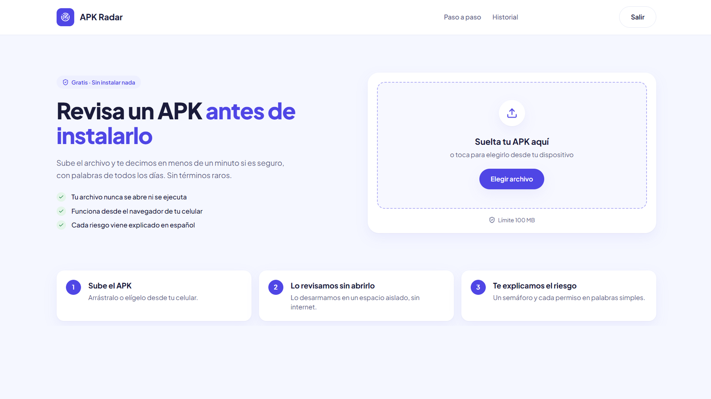

# APK Radar · API (`fakeapp-radar-api`)

API de **APK Radar** hecha con FastAPI. Recibe un APK, lo analiza de forma **estática** (sin ejecutarlo) y devuelve los permisos que pide, su gravedad y un puntaje de riesgo de 0 a 100.

Proyecto final de Seguridad Informática · Universidad Politécnica de Chiapas.

## Cómo funciona
1. El usuario sube el APK (`POST /api/analyses`, máximo 100 MB) y la API responde `202` con un identificador.
2. Un *worker* de Celery abre el APK como archivo ZIP, lee solo el `AndroidManifest.xml` y compara los permisos con un catálogo curado guardado en PostgreSQL.
3. El puntaje es la suma de los pesos de los permisos, con tope de 100: **bajo 0–29, medio 30–59, alto 60–100**.
4. Otro *worker* (`vt-worker`) consulta el hash en VirusTotal respetando el límite gratuito.
5. El resultado se consulta en `GET /api/analyses/{id}`.

## Endpoints
| Método | Ruta | Descripción |
|---|---|---|
| POST | `/api/auth/register` | Crear cuenta |
| POST | `/api/auth/login` | Iniciar sesión |
| POST | `/api/auth/refresh` | Renovar el token (cookie `HttpOnly`) |
| POST | `/api/auth/logout` | Cerrar sesión |
| GET | `/api/auth/me` | Datos del usuario |
| POST | `/api/analyses` | Subir un APK |
| GET | `/api/analyses` | Historial del usuario |
| GET | `/api/analyses/{id}` | Resultado de un análisis |
| GET | `/api/health` | Estado del servicio |

## Seguridad implementada
| Principio | Mecanismo |
|---|---|
| Autenticación | Contraseñas con Argon2id, tokens JWT firmados con RS256 (15 min) y refresco por cookie `HttpOnly` |
| Autorización | Cada análisis pertenece a un usuario; si no es tuyo responde 404 |
| Confidencialidad | TLS 1.3 en el proxy (Caddy), reportes de análisis cifrados con AES-256-GCM en la base de datos |
| Disponibilidad | *Rate limiting* (5/min en login, registro y subida; 120/min general), retención automática de datos |
| Integridad | Validación de entradas con Pydantic, consultas parametrizadas con SQLAlchemy, solo JSON en Celery (sin `pickle`) |
| Cabeceras | HSTS, `nosniff`, `X-Frame-Options: DENY`, `Referrer-Policy: no-referrer`, `Cache-Control: no-store` |

Revisión de código y contenedores con Semgrep, CodeQL, Trivy y OWASP ZAP (carpeta `security/`, reporte en `docs/`).

## Tecnologías
Python · FastAPI · SQLAlchemy · Celery · Redis · PostgreSQL · Docker Compose · Caddy.

## Correr en desarrollo
Primero levanta la base de datos (repo `fakeapp-radar-db`), luego:
1. `python -m venv .venv` y activar con `.\.venv\Scripts\Activate.ps1`
2. `pip install -r requirements.txt`
3. Copiar `.env.example` a `.env` y completar los valores (genera las claves con los comandos que indica el archivo)
4. `uvicorn app.main:app --reload`
5. Documentación interactiva en http://127.0.0.1:8000/docs

## Con Docker
`docker compose up -d --build` (desarrollo) o `docker-compose.prod.yml` con el proxy HTTPS (producción, ver `deploy/`).

## Pruebas
`python -m pytest -q`

## Estructura
| Carpeta | Contenido |
|---|---|
| `app/` | Código: `analysis/`, `auth/`, `routers/`, `worker/`, `vt/` |
| `tests/` | Pruebas automáticas (pytest) |
| `deploy/` | Scripts para el servidor AWS |
| `security/` | Reglas y reportes de Semgrep, CodeQL, Trivy y ZAP |
| `docs/` | Reporte de seguridad |

## Repositorios relacionados
- Frontend: https://github.com/Miteek2000/fakeapp-radar-web
- Base de datos: https://github.com/Miteek2000/fakeapp-radar-db

## Licencia
MIT. Ver [LICENSE](LICENSE).
